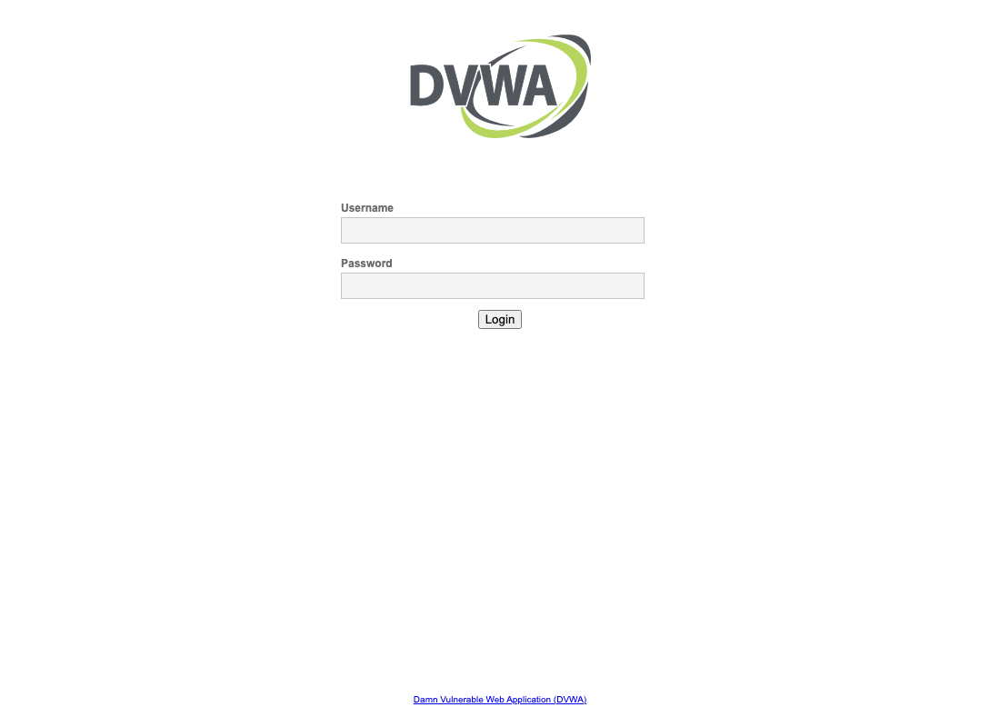
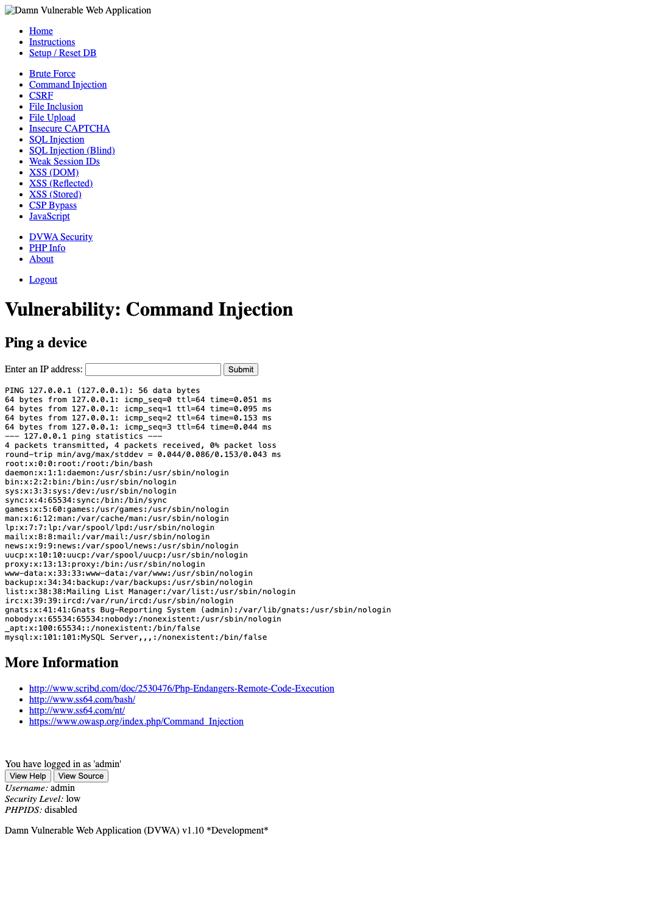

# Testing and verification

The [defense test matrix](Defense-Test-Matrix.md) records the October 27, 2026 results, check references and outstanding evidence for each control.

* **Guest isolation.** The Guest host lost ping reachability to the two tested Business hosts. Direct checks confirmed a timeout to DVWA on port 80 even though the historical suite reported a failure for HTTP. [segmentation comparison](../evidence/verification/segmentation-before-after.md) and [suite output](../evidence/verification/verify-defenses-after.txt).
* **Endpoint controls.** With routing open, the Alpine workstation's own firewall dropped Guest traffic. Its INPUT counters identify the enforcing layer. [workstation comparison](../evidence/verification/us9-endpoint-hardening.md).
* **Web controls.** The benign lookup succeeded and the WAF blocked both tested injection cases. Direct DVWA access succeeded in the monitoring capture and was blocked in the routed and three-segment runs. [monitoring run](../evidence/defense/waf-monitoring-verify-20261027T142318Z.txt), [routed run](../evidence/defense/waf-routed-verify-20261027T135519Z.txt) and [three-segment run](../evidence/defense/segmented-verify-20261027T143306Z.txt).
* **Business service.** The workstation reached the business portal in the recorded build check. A matched before/after pair under hardening remains outstanding under #105. [Build check with command and exit code](../evidence/build/us4-workstation-to-server.txt).
* **Monitoring.** Router denial correlation, Suricata-to-Wazuh delivery and detection latency still need dated records. The WAF matches are documented in the [detection mapping](Detection-Mapping.md).

## Before and after evidence for US-12

| Observation on October 27, 2026 | Before | After |
|---|---|---|
| Guest HTTP to DVWA on the Business network | DVWA redirected the client to login (HTTP 302). [Baseline comparison](../evidence/verification/segmentation-before-after.md) | The original suite reported a failure. The direct check recorded `Connection timed out after 4s`. [Suite output](../evidence/verification/verify-defenses-after.txt) · [Follow-up output](../evidence/verification/segmentation-ground-truth.txt) |
| Guest ping to the employee workstation with open routing | The Alpine workstation replied to all three packets. | After host firewall hardening, all three were lost. Its INPUT rules counted six packets each for LOG and DROP across the probes. [Endpoint comparison](../evidence/verification/us9-endpoint-hardening.md) |
| Web request through the café application | The authenticated follow-up on the initialized baseline returned file content. The first scripted run had returned no output. [Dated validation](../evidence/attack/undefended-validation-20261027T055623Z.md) | In the three-segment run, the WAF returned HTTP 403 for the tested command injection. The control request recorded `benign lookup passes (200, one row)`. [Defended output](../evidence/defense/segmented-verify-20261027T143306Z.txt) |

**Screenshots from the undefended application.** The first capture shows the login page. The second records the result of the authenticated follow-up. The defended observations above come from terminal output.

| Login page | Authenticated result |
|---|---|
|  |  |
