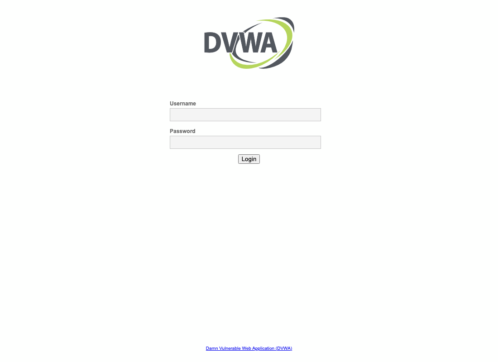
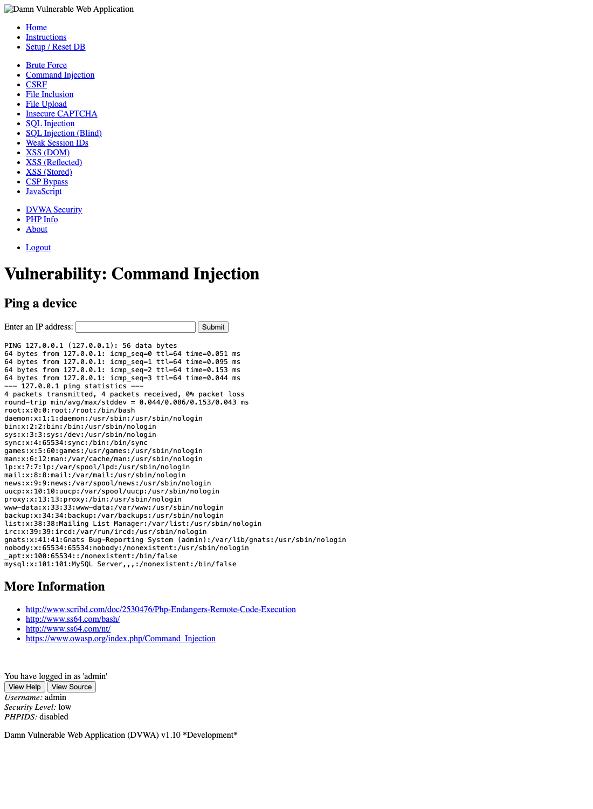

# Undefended Attack Write-Up

> Issue #4: *Document the undefended base attack with evidence.*
> Attacks are run from Kali on the Guest network, against the lab with **no defenses applied**. Each attack lists its objective, target, preconditions, procedure, the expected result, the actual result, and the evidence.
> The actual results are from the live run on 2026-10-27 (Docker Desktop 4.48.0, macOS 13.7.8). Raw output and the per-step report are linked under each attack.

---

## Lab preconditions (all attacks)

- The lab is started with `docker compose -f docker/docker-compose.yml up -d firewall dvwa workstation kali`.
- The firewall runs in undefended mode: `FORWARD ACCEPT`, no `DROP` rules. Confirm with `docker exec swagpc-firewall iptables -S FORWARD`.
- DVWA's database is initialized. On a fresh lab, run DVWA's *Create / Reset Database* step once (`setup.php`). Without it, login redirects to `setup.php` and the injection returns nothing (see [#3](https://github.com/bash-y/CIS_CapstoneProj_Swag01erload/issues/3)).
- Kali has a route to the business subnet through the firewall: `ip route add 192.168.20.0/24 via 192.168.10.254`.

| Host | Address | Role |
|---|---|---|
| Kali (attacker) | `192.168.10.50` | Guest network |
| Firewall / router | `192.168.10.254`, `192.168.20.254` | Router, undefended |
| DVWA (café web app) | `192.168.20.10` | Business network, port 80 |
| Employee workstation | `192.168.20.25` | Business network |

---

## Attack 1: Network reconnaissance

**Objective:** Find which hosts and services are reachable from the Guest network.

**Target:** Business subnet `192.168.20.0/24`.

**Preconditions:** Lab preconditions above.

**Procedure** (`scripts/attack/recon-scan.sh`, part of `run-full-attack.sh`):
1. Ping `192.168.20.10` and `192.168.20.25` three times each.
2. Run an nmap port scan of the business subnet on ports 22, 80, 445, 3389, 8080.

**Expected (undefended):** Ping replies from both hosts. Port 80 open on `.10`.

**Actual:**
- Ping: `.10` and `.25` each reply 3/3, 0% loss.
- nmap: hosts `.10`, `.25` and `.254` respond. Port 80 is open on `.10` (`Apache httpd 2.4.25`).

**Evidence:** [`evidence/attack/undefended-run-20261027T055623Z.txt`](../evidence/attack/undefended-run-20261027T055623Z.txt), section *ATTACK 1*. Per-step table in [`evidence/attack/undefended-validation-20261027T055623Z.md`](../evidence/attack/undefended-validation-20261027T055623Z.md).

---

## Attack 2: Web command injection (DVWA)

**Objective:** Run an operating-system command on the café web server through a vulnerable form, and read `/etc/passwd`.

**Target:** DVWA, `http://192.168.20.10/vulnerabilities/exec/`.

**Preconditions:** Lab preconditions above, **including the DVWA database initialized**. The security level is `low`, which DVWA sets by default.

**Procedure** (`scripts/attack/dvwa-exploit.sh`):
1. Check reachability: `curl -I http://192.168.20.10/`. Expect HTTP 302 to the login page.
2. Log in as `admin` / `password`. Keep the session cookie.
3. Submit the payload to the exec form:
   ```
   ip=127.0.0.1;cat+/etc/passwd&Submit=Submit
   ```

**Expected (undefended):** The response contains the contents of `/etc/passwd`.

**Actual:**
- Reachability: HTTP 302 to `login.php`. Pass.
- Injection after the database reset: HTTP 200, and the response contains `root:x:0:0:root:/root:/bin/bash`. Pass.
- Injection on a fresh lab, before the reset: no output, because login redirects to `setup.php`. Fail until the reset runs.

**Evidence:** [`evidence/attack/undefended-validation-20261027T055623Z.md`](../evidence/attack/undefended-validation-20261027T055623Z.md), section *Update*. Raw HTTP output of the reachability check is in the run file, section *ATTACK 2*.

**Screenshots** (captured 2026-10-27 on the undefended lab):

| | |
|---|---|
|  |  |
| DVWA login page at `http://192.168.20.10/login.php` | Command-injection result after logging in as `admin` (security level `low`). The response shows the ping output followed by `/etc/passwd`, including `root:x:0:0`. |

The result page is also saved as HTML in [`evidence/attack/dvwa-cmdi-response.html`](../evidence/attack/dvwa-cmdi-response.html), so the screenshot can be regenerated.

**Caveat:** `run-full-attack.sh` does not perform the database reset or log in with the DVWA token, so its web step still fails on a fresh lab. This is tracked in [#48](https://github.com/bash-y/CIS_CapstoneProj_Swag01erload/issues/48).

---

## Attack 3: Lateral reachability to the employee workstation

**Objective:** From the Guest network, reach the employee workstation on the business network, and see which of its services answer.

**Target:** Employee workstation, `192.168.20.25`.

**Preconditions:** Lab preconditions above.

**Procedure** (`scripts/attack/lateral-test.sh`, part of `run-full-attack.sh`):
1. Ping `192.168.20.25` three times.
2. Run an nmap scan of ports 22, 80, 445, 3389.

**Expected (undefended):** Ping replies. The host is up. Services on 22, 80, 445 and 3389 would show as open if the workstation ran them.

**Actual:**
- Ping: 3/3 replies, 0% loss. Pass.
- nmap: host up. All four ports are **closed**, not open. The workstation is an Alpine container with no listening services, so the earlier claim of an open SMB share (445) does not hold. See discrepancy 3 in [`wiki/Attack.md`](Attack.md) §5.

**Evidence:** [`evidence/attack/undefended-run-20261027T055623Z.txt`](../evidence/attack/undefended-run-20261027T055623Z.txt), section *ATTACK 3*.

---

## Attack 4: SQL injection (DVWA)

**Objective:** Read data the application should not expose, from the `users` table, through the vulnerable `id` parameter.

**Target:** DVWA SQL injection page, `http://192.168.20.10/vulnerabilities/sqli/`, parameter `id`.

**Preconditions:** Lab preconditions above, **including the DVWA database initialized** and a logged-in session (the page needs login). The security level is `low`.

**Procedure** (`scripts/attack/sqli-exploit.sh`, repeatable):
1. Log in as `admin` / `password`.
2. Baseline query `id=1`. Expect one row.
3. Boolean injection `id=1' OR '1'='1`. Expect every user.
4. UNION injection `id=1' UNION SELECT user,password FROM users#`. Expect every username with its password hash.

**Expected (undefended):** The baseline returns one row. The boolean and UNION payloads return every user. The UNION returns the password hash column.

**Actual (2026-10-27):**
- Baseline: one row, `admin`. Pass.
- Boolean: all five users returned (`admin`, `Gordon Brown`, `Hack Me`, `Pablo Picasso`, `Bob Smith`). Pass.
- UNION: all five usernames returned with their password hashes. Pass. Each hash is an unsalted MD5. The `admin` hash is the MD5 of `password`, DVWA's default.

**Evidence:** [`evidence/attack/sqli-run-20261027T060230Z.txt`](../evidence/attack/sqli-run-20261027T060230Z.txt) (the full script run, with timestamp). The boolean and UNION outputs are printed in that run.

**Repeat after defenses:** Re-run `sqli-exploit.sh` after an application-layer fix. The injected rows should no longer appear. This is the re-test for Defense Test Matrix row 4.

---

## What this shows

On the undefended build, a host on the Guest network reaches the business subnet, enumerates the café web server, and gets `/etc/passwd` through the injection. The workstation answers ping, so it is reachable even though it exposes no services. Each of these is the baseline that the defenses are re-tested against in [`wiki/Defense-Test-Matrix.md`](Defense-Test-Matrix.md).

## Gaps in this write-up

- **Screenshots** are not included. The captured terminal output is the evidence for now. Screenshots of the DVWA response can be added on request.
- **Screenshots of the SQL injection** are not included. The captured terminal output in the run file is the evidence.
